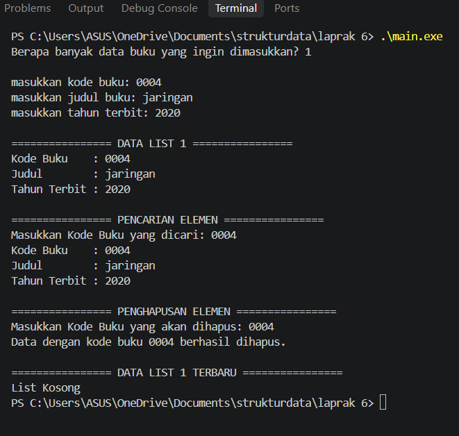

# <h1 align="center">Laporan Praktikum Modul 6 - Doubly Linked List (Bagian Pertama)</h1>
<p align="center">Ignatius Steven M. - 109082500089</p>

## Dasar Teori

Doubly Linked List adalah struktur data linier berupa simpul yang saling terhubung menggunakan dua pointer, yaitu `next` untuk maju dan `prev` untuk mundur, di mana pengelolaannya dikendalikan oleh pointer `First` dan `Last`. Komponen utamanya terdiri dari `infotype` untuk menyimpan data seperti kode, judul, dan tahun terbit buku, `address` sebagai penunjuk alamat memori, serta `ElmList` dan `List` itu sendiri. Dalam penerapannya, struktur ini didukung oleh berbagai operasi dasar seperti pembuatan list kosong (`CreateList`), pengaturan memori (`alokasi` dan `dealokasi`), validasi duplikasi dan penambahan elemen di akhir (`insertLast`), pencarian elemen menggunakan fungsi `findElm`, serta penghapusan elemen melalui prosedur `deleteFirst`, `deleteLast`, maupun `deleteAfter`.

## Unguided

### 1. Struktur Data Buku pada Buku.h

```cpp
#ifndef BUKU_H_INCLUDED
#define BUKU_H_INCLUDED

#include <iostream>
#include <string>

using namespace std;

struct buku {
    string kodeBuku;
    string judul;
    int thnTerbit;
};

typedef buku infotype;
typedef struct ElmList *address;

struct ElmList {
    infotype info;
    address next;
    address prev;
};

struct List {
    address First;
    address Last;
};

void CreateList(List &L);
address alokasi(infotype x);
void dealokasi(address &P);
address findElm(List L, string kodeBuku);
void insertLast(List &L, address P);
void printInfo(List L);
void deleteFirst(List &L, address &P);
void deleteLast(List &L, address &P);
void deleteAfter(address Prec, address &P);
void deleteByKode(List &L, string kodeBuku);

#endif
```

File Buku.h (Header File) berfungsi sebagai wadah deklarasi struktur data dan fungsi utama yang mencakup definisi tipe bentukan buku untuk infotype, pointer address, elemen list (ElmList), struktur pengelola list (List), serta seluruh purwarupa prosedur dan fungsi seperti CreateList, alokasi, dealokasi, findElm, insertLast, printInfo, hingga berbagai prosedur penghapusan elemen (deleteFirst, deleteLast, deleteAfter, dan deleteByKode).

### 2. Implementasi Fungsi pada Buku.cpp

```cpp
#include "Buku.h"

void CreateList(List &L) {
    L.First = NULL;
    L.Last = NULL;
}

address alokasi(infotype x) {
    address P = new ElmList;
    P->info = x;
    P->next = NULL;
    P->prev = NULL;
    return P;
}

void dealokasi(address &P) {
    delete P;
    P = NULL;
}

address findElm(List L, string kodeBuku) {
    address P = L.First;
    while (P != NULL) {
        if (P->info.kodeBuku == kodeBuku) {
            return P;
        }
        P = P->next;
    }
    return NULL;
}

void insertLast(List &L, address P) {
    if (L.First == NULL) {
        L.First = P;
        L.Last = P;
    } else {
        L.Last->next = P;
        P->prev = L.Last;
        L.Last = P;
    }
}

void printInfo(List L) {
    address P = L.First;
    if (P == NULL) {
        cout << "List Kosong" << endl;
    } else {
        while (P != NULL) {
            cout << "Kode Buku    : " << P->info.kodeBuku << endl;
            cout << "Judul        : " << P->info.judul << endl;
            cout << "Tahun Terbit : " << P->info.thnTerbit << endl;
            cout << endl;
            P = P->next;
        }
    }
}

void deleteFirst(List &L, address &P) {
    if (L.First == NULL) {
        P = NULL;
    } else if (L.First == L.Last) {
        P = L.First;
        L.First = NULL;
        L.Last = NULL;
    } else {
        P = L.First;
        L.First = P->next;
        L.First->prev = NULL;
        P->next = NULL;
    }
}

void deleteLast(List &L, address &P) {
    if (L.First == NULL) {
        P = NULL;
    } else if (L.First == L.Last) {
        P = L.First;
        L.First = NULL;
        L.Last = NULL;
    } else {
        P = L.Last;
        L.Last = P->prev;
        L.Last->next = NULL;
        P->prev = NULL;
    }
}

void deleteAfter(address Prec, address &P) {
    if (Prec != NULL && Prec->next != NULL) {
        P = Prec->next;
        Prec->next = P->next;
        if (P->next != NULL) {
            P->next->prev = Prec;
        }
        P->next = NULL;
        P->prev = NULL;
    } else {
        P = NULL;
    }
}

void deleteByKode(List &L, string kodeBuku) {
    address P = findElm(L, kodeBuku);
    if (P == NULL) {
        cout << "Data dengan kode buku " << kodeBuku << " tidak ditemukan." << endl;
    } else {
        address Q = NULL;
        if (P == L.First) {
            deleteFirst(L, Q);
        } else if (P == L.Last) {
            deleteLast(L, Q);
        } else {
            deleteAfter(P->prev, Q);
        }
        dealokasi(Q);
        cout << "Data dengan kode buku " << kodeBuku << " berhasil dihapus." << endl;
    }
}
```

File Buku.cpp (Implementation File) berisi implementasi teknis dari seluruh fungsi dan prosedur yang telah dideklarasikan sebelumnya, mulai dari fungsi inisialisasi list kosong, manajemen alokasi dan dealokasi memori, pencarian data menggunakan findElm, penambahan elemen di akhir lewat insertLast, penampilan data dengan printInfo, hingga logika penghapusan simpul baik di awal, akhir, maupun setelah node tertentu, serta penanganan validasi kode buku agar tidak terjadi duplikasi data.

### 3. Program Utama main.cpp

```cpp
#include "Buku.h"

int main() {
    List L1;
    CreateList(L1);

    int n;
    cout << "Berapa banyak data buku yang ingin dimasukkan? ";
    cin >> n;

    for (int i = 0; i < n; i++) {
        infotype b;
        cout << "\nmasukkan kode buku: ";
        cin >> b.kodeBuku;

        if (findElm(L1, b.kodeBuku) != NULL) {
            cout << "kode buku sudah terdaftar" << endl;
            i--; 
            continue;
        }

        cout << "masukkan judul buku: ";
        cin >> b.judul;
        cout << "masukkan tahun terbit: ";
        cin >> b.thnTerbit;

        address P = alokasi(b);
        insertLast(L1, P);
    }

    cout << "\n================ DATA LIST 1 ================\n";
    printInfo(L1);

    cout << "================ PENCARIAN ELEMEN ================\n";
    string cariKode;
    cout << "Masukkan Kode Buku yang dicari: ";
    cin >> cariKode;
    
    address hasilCari = findElm(L1, cariKode);
    if (hasilCari != NULL) {
        cout << "Kode Buku    : " << hasilCari->info.kodeBuku << endl;
        cout << "Judul        : " << hasilCari->info.judul << endl;
        cout << "Tahun Terbit : " << hasilCari->info.thnTerbit << endl;
    } else {
        cout << "Data tidak ditemukan." << endl;
    }

    cout << "\n================ PENGHAPUSAN ELEMEN ================\n";
    string hapusKode;
    cout << "Masukkan Kode Buku yang akan dihapus: ";
    cin >> hapusKode;
    
    deleteByKode(L1, hapusKode);

    cout << "\n================ DATA LIST 1 TERBARU ================\n";
    printInfo(L1);

    return 0;
}
```

File main.cpp (Main Program) bertindak sebagai pengendali utama eksekusi program yang menguji keseluruhan ADT Doubly Linked List dengan cara meminta input data buku dari pengguna, melakukan validasi pengecekan duplikasi kodeBuku, menampilkan isi list, menjalankan fungsi pencarian elemen berdasarkan kode buku tertentu, serta mengeksekusi prosedur penghapusan data dan menampilkan kondisi akhir list secara berurutan sesuai skenario praktikum.

### 4. Hasil Output Program



## Kesimpulan

Doubly Linked List adalah struktur data linier yang terdiri dari simpul-simpul yang saling terhubung menggunakan dua pointer, yaitu next dan prev, serta dikendalikan oleh pointer First dan Last. Berdasarkan praktikum yang dilakukan, ADT ini terbukti efektif dalam mengelola data berbasis objek seperti data buku—yang mencakup kodeBuku, judul, dan thnTerbit—karena dilengkapi dengan mekanisme operasi yang terstruktur seperti validasi duplikasi data, penambahan elemen di akhir (insertLast), pencarian data berdasarkan elemen tertentu (findElm), serta penghapusan elemen baik di awal, akhir, maupun setelah simpul tertentu (deleteFirst, deleteLast, deleteAfter).

## Referensi

Cormen, T. H., Leiserson, C. E., Rivest, R. L., & Stein, C. (2009). Introduction to Algorithms (3rd ed.). MIT Press. (Menjelaskan konsep dasar struktur data Linked List, pointer manipulation, dan kompleksitas algoritma).

Goodrich, M. T., Tamassia, R., & Mount, D. M. (2011). Data Structures and Algorithms in C++ (2nd ed.). John Wiley & Sons. (Membahas implementasi Doubly Linked List, Abstract Data Type/ADT, serta pengalokasian memori dinamis pada C++).

Stroustrup, B. (2013). The C++ Programming Language (4th ed.). Addison-Wesley. (Referensi standar sintaks C++, struktur data struct, pointer, dan alokasi memori dinamis new/delete).